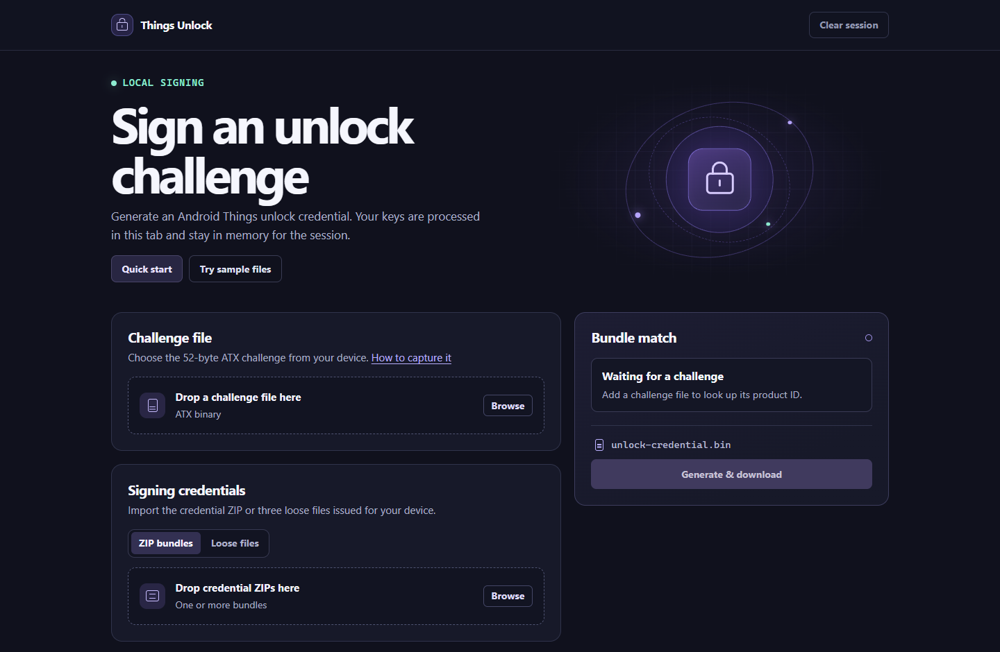
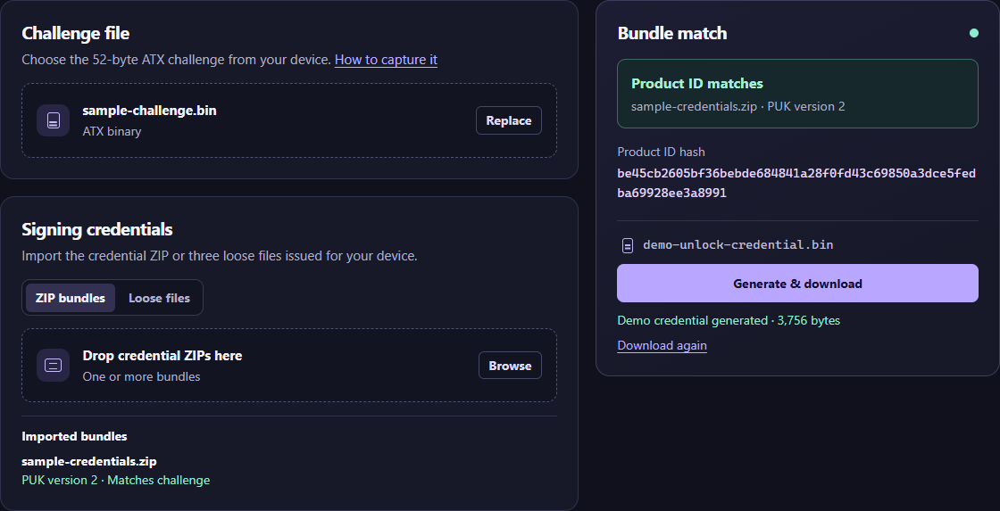
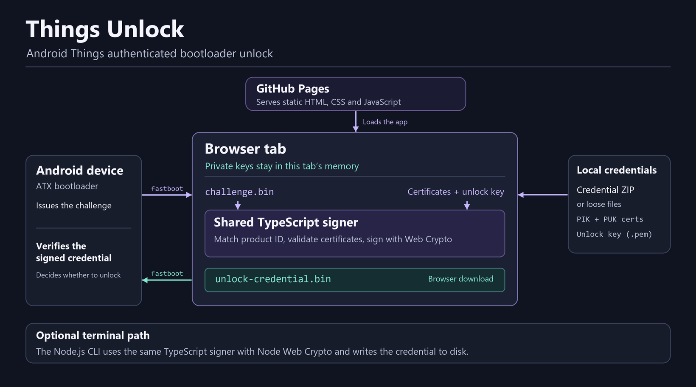

# Things Unlock

Things Unlock generates a binary Android Things authenticated AVB unlock credential locally. It requires the 52-byte ATX challenge file and a credential set issued for the target product. Device acceptance depends on the bootloader's current challenge, trust chain, and key versions.

## Desktop screenshots



**Sample signing result**



## Architecture



## Using the signer

Open **Quick start** for the PowerShell steps to capture a challenge, sign it, and check the bootloader state. Bring the credential bundle issued for your product. For a practice run, choose **Try sample files**. The demo uses synthetic credentials and downloads `demo-unlock-credential.bin`.

For hardware use, check the instructions for your exact model and firmware before changing its bootloader state. Hardware verification of this release is pending. The signer has passed byte-for-byte AOSP tests, including a user-supplied credential ZIP with a synthetic challenge.

When reporting an issue, include the exact model, firmware, Platform-Tools version, and a redacted fastboot error. Keep private keys, credential bundles, and device serials out of public reports.

## Web build and offline package

Build the static site with Node.js 22 or later and serve it over HTTPS or on localhost. The build uses relative asset paths for GitHub Pages project sites.

```sh
npm ci
npm run build:web
python -m http.server 4173 --bind 127.0.0.1 --directory dist-web
```

Open [the local preview](http://127.0.0.1:4173/). Add the challenge, import ZIP bundles or the three loose files, and download the signed credential. The page processes keys and challenges in memory and exposes a **Clear session** button. Its content security policy blocks outbound script connections.

The **Offline ZIP** and **SHA-256** links point to the versioned files in `dist-web/downloads/`. Extract the ZIP and follow `START-HERE.txt` to run it over localhost. On Windows, use `Get-FileHash .\things-unlock-v0.1.0-offline.zip -Algorithm SHA256` and compare the hash with the `.sha256` file. On macOS or Linux, use `shasum -a 256 -c things-unlock-v0.1.0-offline.zip.sha256`.

To deploy, set the repository’s Pages source to **GitHub Actions**. The included workflow publishes the default branch’s build, including the offline package and a link to the exact source commit. The ZIP and checksum can also be attached to the matching GitHub Release. [GitHub Pages setup](https://docs.github.com/en/pages/getting-started-with-github-pages/configuring-a-publishing-source-for-your-github-pages-site)

## CLI

Install dependencies and build with Node.js 22 or later.

```sh
npm ci
npm run build
```

Use a Developer Console ZIP or supply the two ATX binary certificates and the unlock private key as loose files. Both forms accept unencrypted RSA-4096 PKCS#8 and PKCS#1 PEM keys.

```sh
node dist/cli.js sign --challenge challenge.bin --bundle device.zip --out unlock.bin
node dist/cli.js sign --challenge challenge.bin --pik-cert pik.bin --puk-cert puk.bin --puk-key puk.pem --out unlock.bin
```

Repeat `--bundle` to search several archives. The signer requires exactly one match and a new output path. Run `node dist/cli.js --help` for usage. The ZIP importer extracts the three credential files in memory.

## Shared library

`src/index.ts` is the browser-compatible entry point. Pass a Web Crypto provider's `subtle` object to `createSigner`. Read ZIPs with `readCredentialZip`, or pass loose files as `{ pikCert, pukCert, pukKeyPem }` byte arrays. `importBundle` returns a handle with the bundle name, product ID hash, and unlock key version. Use `parseChallenge` and `findMatches` for preview, then pass the original challenge bytes and a selected handle to `createCredential` on the same signer. The return value contains the complete binary credential.

## AOSP parity test

With Python 3 and OpenSSL on `PATH`, run `npm run test:aosp`. The test downloads a hash-checked copy of [AOSP avbtool](https://android.googlesource.com/platform/external/avb/+/23c8439bb647e483b80f9bac6974798a06a4ae5f/avbtool.py), generates a synthetic certificate chain in a temporary directory, and compares the complete CLI output across both containers and both PEM formats. To use an existing copy of the pinned reference, build first and run `python test/verify_aosp.py --avbtool /path/to/avbtool.py`.

To regenerate the intentionally public synthetic demo fixture, build the CLI and run `python test/verify_aosp.py --write-demo web/demo-fixture.json`.
